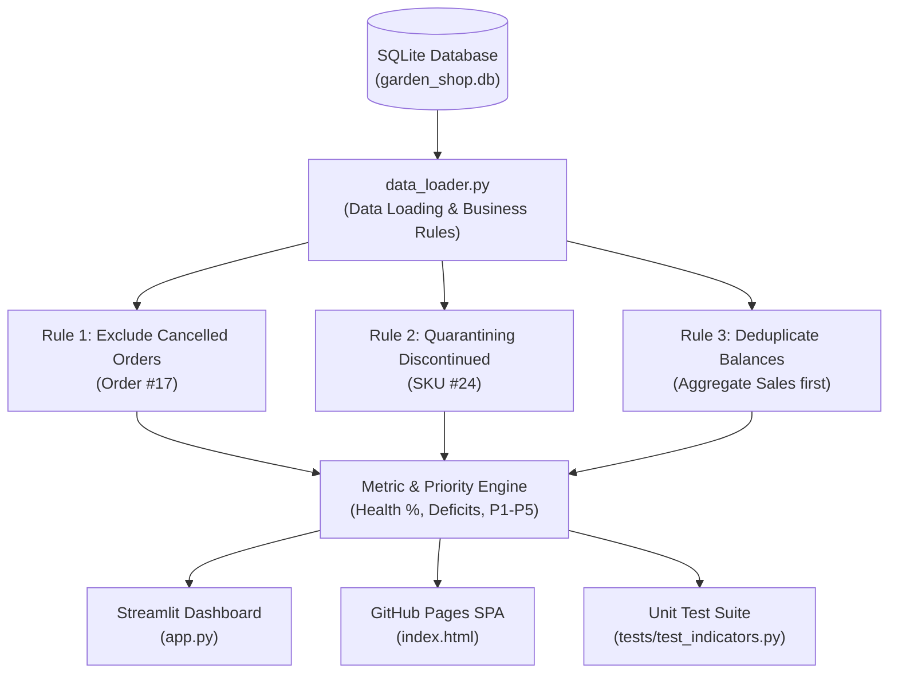

# SPEC — Software Specification

> **Objective:** Transform product requirements into a verifiable technical specification that guides software implementation, data pipeline contracts, testing, and validation.
> **SDD reference document:** This specification is the source of truth for approved technical, algorithmic, and behavioral requirements for Task 02.

---

## 1. Metadata
- **Project:** Garden Shop Inventory Monitoring & Restocking Decision Support Dashboard
- **Specification version:** 1.0
- **Status:** Approved
- **Related PRD:** [`PRD.md`](./PRD.md)
- **Approval owner:** Raquel Marques
- **Date:** 2026-11-01

### Allowed Statuses
- `Approved`: approved for implementation.

---

## 2. Technical Objective

Deliver a modular, test-driven Python application and interactive dashboard that ingests the relational tables from `data/garden_shop.db`, enforces core business rules (cancellation exclusion, discontinued product segregation, and join balance deduplication), calculates operational indicators, and exposes an intuitive user interface with real-time multi-dimensional filtering.

---

## 3. References and Traceability

| PRD Requirement | SPEC Requirement | Validation Test Case |
|---|---|---|
| **FR-001** (Inventory Health Index) | **REQ-001** (Health Index Calculation) | `TEST-001` (`test_inventory_health_index_active`) |
| **FR-002** (Replenishment Capital Deficit) | **REQ-002** (Capital Deficit Calculation) | `TEST-002` (`test_capital_deficit_to_rop`) |
| **FR-003** (Cancellation Exclusion) | **REQ-003** (Cancelled Order Filtration) | `TEST-003` (`test_cancelled_order_exclusion`) |
| **FR-004** (Discontinued Segregation) | **REQ-004** (Discontinued Product Handling) | `TEST-004` (`test_discontinued_product_isolation`) |
| **FR-005** (Multi-Dimensional Filters) | **REQ-005** (Filter Predicate Execution) | `TEST-005` (`test_filter_execution_and_empty_state`) |
| **FR-006** (Priority Triage Engine) | **REQ-006** (Priority Tier Classification) | `TEST-006` (`test_priority_tier_assignment`) |
| **FR-007** (Missing Contact Alert) | **REQ-007** (Vendor Contact Validation) | `TEST-007` (`test_missing_supplier_email_alert`) |

---

## 4. Technical Scope

### 4.1. Included
- Data loading and semantic transformation pipeline (`data_loader.py`).
- Aggregation of sales volume and gross revenue excluding `status = 'cancelled'`.
- Independent aggregation of product stock values prior to joining with order items.
- Calculation of KPIs: Inventory Health %, Critical Stockouts, Understocked SKUs, Capital Needed ($), Active Stock at Cost ($), and Revenue at Risk ($).
- Priority classification engine (P1 Urgent to P5 Healthy).
- Automated unit test suite (`tests/test_indicators.py`) using `pytest` / `unittest`.
- Interactive Streamlit dashboard application (`app.py`).
- Standalone HTML5/Tailwind/Chart.js zero-server web dashboard (`index.html`).

### 4.2. Excluded
- Database modification (all queries are read-only `SELECT` statements).
- Network API calls to external ERP/purchasing endpoints.
- Machine learning libraries (scikit-learn, prophet, statsmodels) not required for core scope.

---

## 5. Proposed Architecture

### 5.1. Overview
The solution follows a clean 3-tier modular architecture:
1. **Data Layer (`garden_shop.db`):** Authoritative SQLite relational store.
2. **Logic & Transformation Layer (`data_loader.py`):** Encapsulates SQL queries, business rule enforcement, metric calculations, and data normalization.
3. **Presentation Layer (`app.py` & `index.html`):** Interactive UI rendering KPI cards, responsive filters, diagnostic charts, and the restock action table.

### 5.2. Components

| Component | Responsibility | Inputs | Outputs |
|---|---|---|---|
| `data_loader.py` | Connects to SQLite, executes business-rule compliant queries, extracts metrics. | `data/garden_shop.db` | DataFrames: `df_products`, `df_categories`, `df_suppliers`, `kpi_summary`. |
| `tests/test_indicators.py` | Unit tests verifying calculation rules on subsets and edge cases. | Mock Data / Fixtures | Test assertions (Pass/Fail). |
| `app.py` | Streamlit interactive dashboard with sidebar filters, charts, and table. | `data_loader.py` DataFrames | Interactive Web UI on `localhost:8501`. |
| `index.html` | Client-side standalone dashboard for GitHub Pages deployment. | Embedded JSON data | Static Web UI with dynamic JS filtering. |

### 5.3. Execution Flow



---

## 6. Behavioral Requirements

### REQ-001 — Health Index Calculation
- **Origin:** FR-001
- **Description:** Calculate the percentage of active products meeting or exceeding their safety reorder point.
- **Formula:** 
  $$\text{Health Index} = \frac{\sum [ \text{discontinued} = 0 \text{ AND } \text{quantity\_on\_hand} \ge \text{reorder\_level} ]}{\sum [ \text{discontinued} = 0 ]} \times 100$$
- **Preconditions:** Active products count $> 0$.
- **Expected Baseline Result:** 18 healthy / 23 active = **78.3%**.

### REQ-002 — Replenishment Capital Deficit Calculation
- **Origin:** FR-002
- **Description:** Compute total acquisition capital required to restore all depleted active products back to their minimum reorder point.
- **Formula:**
  $$\text{Capital Deficit} = \sum_{\text{active}} \max(0, \text{reorder\_level} - \text{quantity\_on\_hand}) \times \text{cost}$$
- **Expected Baseline Result:**
  - Hanging Basket (#14): $(10 - 0) \times \$6.00 = \$60.00$
  - Hand Cultivator (#11): $(10 - 3) \times \$3.50 = \$24.50$
  - Tomato Seeds 'Roma' (#7): $(40 - 5) \times \$0.90 = \$31.50$
  - Orchid Food (#20): $(10 - 6) \times \$4.00 = \$16.00$
  - Pothos 'Golden' (#4): $(12 - 8) \times \$5.00 = \$20.00$
  - **Total Deficit Units = 60 units; Total Capital Required = $152.00.**

### REQ-003 — Cancelled Order Filtration
- **Origin:** FR-003
- **Description:** Order items linked to orders where `orders.status == 'cancelled'` must be filtered out before computing sales quantity and revenue.
- **Validation:** Order #17 has `order_id = 17, status = 'cancelled'`, containing 1 unit of *Pruning Shears* (item 33, price $22.00). *Pruning Shears* also has 1 unit in Order #7 (`status = 'pending'`). Total valid sold units for *Pruning Shears* must equal **1**, not 2. Total store sales must equal **86 units**, not 87.

### REQ-004 — Discontinued Product Segregation
- **Origin:** FR-004
- **Description:** Products with `discontinued == 1` (*Bird Feeder*, SKU #24) must have `suggested_po_units = 0` and be excluded from restock deficit calculations.
- **Validation:** Bird Feeder has stock = 4, reorder_level = 6. Deficit to ROP is mathematically 2, but restock recommendation must be **0** and priority tier must be **`P4: Discontinued`**.

### REQ-005 — Balance Deduplication in Joins
- **Origin:** BR-004
- **Description:** When calculating on-hand inventory value at cost, products must not be joined to `order_items` without prior aggregation, which would duplicate `quantity_on_hand` across multiple line items.
- **Formula:** Total Active Cost = $\sum_{p \in \text{products}, \text{disc}=0} (p.\text{quantity\_on\_hand} \times p.\text{cost})$.
- **Expected Baseline Result:** **$4,731.00** across 933 active units.

### REQ-006 — Multi-Tier Priority Classification Engine
- **Origin:** FR-006
- **Algorithm:**
  ```python
  if discontinued == 1:
      return "P4: Discontinued"
  elif quantity_on_hand == 0:
      return "P1: Critical Stockout"
  elif quantity_on_hand < reorder_level and units_sold >= 4:
      return "P1: Top Seller at Risk"
  elif quantity_on_hand < reorder_level:
      return "P2: Restock Required"
  elif quantity_on_hand < (reorder_level * 1.5):
      return "P3: Watchlist"
  else:
      return "P5: Healthy"
  ```

---

## 7. Data Contracts

### 7.1. Database Schema Specifications (from Data Dictionary)

| Table | Field | Type | Nullable | Primary/Foreign Key | Description |
|---|---|---|---|---|---|
| `categories` | `category_id` | INTEGER | No | PK | Category ID (1 to 8) |
| `categories` | `category_name` | VARCHAR | No | - | Name of category |
| `products` | `product_id` | INTEGER | No | PK | Product ID (1 to 24) |
| `products` | `product_name` | VARCHAR | No | - | Product commercial name |
| `products` | `category_id` | INTEGER | No | FK $\to$ `categories` | Category lookup |
| `products` | `supplier_id` | INTEGER | No | FK $\to$ `suppliers` | Supplier lookup |
| `products` | `price` | DECIMAL | No | - | Unit retail selling price |
| `products` | `cost` | DECIMAL | No | - | Unit replacement cost |
| `products` | `quantity_on_hand`| INTEGER | No | - | Current inventory units |
| `products` | `reorder_level`| INTEGER | No | - | Safety reorder threshold |
| `products` | `discontinued` | BOOLEAN | No | - | Discontinued flag |
| `suppliers` | `supplier_id` | INTEGER | No | PK | Supplier ID (1 to 6) |
| `suppliers` | `supplier_name`| VARCHAR | No | - | Commercial supplier name |
| `suppliers` | `contact_email`| VARCHAR | **Yes** | - | Contact email (null for 2 vendors) |
| `suppliers` | `state` | VARCHAR | No | - | Two-letter state code |
| `orders` | `order_id` | INTEGER | No | PK | Order ID (1 to 24) |
| `orders` | `customer_id` | INTEGER | No | FK $\to$ `customers`| Customer placing order |
| `orders` | `order_date` | DATE | No | - | Date order was placed |
| `orders` | `shipped_date` | DATE | **Yes** | - | Shipped date (null for pending/proc/canc) |
| `orders` | `status` | VARCHAR | No | - | shipped, pending, processing, cancelled |
| `order_items` | `order_item_id` | INTEGER | No | PK | Line item ID (1 to 48) |
| `order_items` | `order_id` | INTEGER | No | FK $\to$ `orders` | Order lookup |
| `order_items` | `product_id` | INTEGER | No | FK $\to$ `products` | Product lookup |
| `order_items` | `quantity` | INTEGER | No | - | Units ordered |
| `order_items` | `unit_price` | DECIMAL | No | - | Historical price charged |

---

## 8. Interfaces and Integrations

### 8.1. Data Loader Interface (`data_loader.py`)
```python
def get_connection(db_path: str = None) -> sqlite3.Connection:
    """Returns an active SQLite connection."""

def load_products_master(db_path: str = None) -> pd.DataFrame:
    """Returns master product DataFrame with joined category, supplier,
    aggregated sales (excluding cancellations), deficit metrics, and priority tiers."""

def get_kpi_summary(df_products: pd.DataFrame) -> dict:
    """Calculates KPI metrics from the master product DataFrame."""
```

### 8.2. User Interface (`app.py`)
- **Sidebar:** Multi-select Category dropdown, Supplier dropdown, Priority Tier selectbox, Search text input, Discontinued toggle.
- **Header:** Title, status badge, and procurement warning banner if *Ironwood Tools* is present.
- **Row 1:** 6 KPI scorecards (Health %, Stockouts, Understocked, Capital Needed, Inventory Cost, Revenue at Risk).
- **Row 2:** Diagnostic Charts (Category Health Stacked Bar, Priority Matrix Scatter Plot).
- **Row 3:** Supplier Reorder Summary Bar Chart & Discontinued Clearance Card.
- **Row 4:** Operational Restock Action Workbench (Data table with formatted currency and sorting).
- **Row 5:** "Download Filtered PO Manifest (CSV)" action button.

---

## 9. Business Rules

### BR-001 — Order Status Filtering
- **Rule:** When computing sales velocity and revenue, only include rows where `orders.status IN ('shipped', 'processing', 'pending')`. Exclude `status = 'cancelled'`.

### BR-002 — Discontinued Inventory Handling
- **Rule:** If `products.discontinued == 1` (or `TRUE`), set `deficit_to_min = 0` and `suggested_po_units = 0`. Route SKU to clearance drawer.

### BR-003 — Balance Join Deduplication
- **Rule:** Always aggregate `order_items` by `product_id` in a separate Common Table Expression (CTE) or subquery before joining to `products`.

### BR-004 — Target Par Order Calculation
- **Rule:** For depleted active items, calculate suggested purchase quantity as:
  $$\text{Suggested PO Units} = \max(0, (2 \times \text{reorder\_level}) - \text{quantity\_on\_hand})$$

---

## 10. Technical Decisions (ADR)

| ID | Decision | Justification | Alternatives Considered |
|---|---|---|---|
| **ADR-001** | Use SQLite as primary database interface | Zero setup, preserves relational integrity, matches `data/garden_shop.db` structure. | Loading 6 separate CSVs (rejected per user preference). |
| **ADR-002** | Dual Frontend: Streamlit + Standalone HTML5 | Streamlit offers Python-native interactive exploration; HTML5/Tailwind/Chart.js enables zero-server hosting on GitHub Pages. | Power BI (requires commercial desktop license). |
| **ADR-003** | CTE Pre-Aggregation for Sales | Completely prevents Cartesian join inflation on inventory balances. | Post-join Pandas `drop_duplicates` (fragile and prone to aggregation bugs). |

---

## 11. Testing Strategy

| ID | Scenario | Test Type | Expected Result | Requirement |
|---|---|---|---|---|
| **TEST-001** | Active products inventory health | Unit | Exactly 78.3% (18/23 active safe). | REQ-001 |
| **TEST-002** | Restock capital deficit calculation | Unit | Exactly $152.00 across 60 deficit units. | REQ-002 |
| **TEST-003** | Cancelled order exclusion (Order #17) | Unit | Total valid sales = 86 units ($1,107.00 rev). Pruning Shears = 1 unit. | REQ-003 |
| **TEST-004** | Discontinued product segregation | Unit | Bird Feeder has PO qty = 0, priority = P4. | REQ-004 |
| **TEST-005** | Inventory cost non-duplication | Unit | Total active cost equals $4,731.00 (not inflated by orders). | REQ-005 |
| **TEST-006** | Priority tier assignment | Unit | Hanging Basket = P1 Stockout; Pothos = P1 Bestseller; Roma = P1 Bestseller. | REQ-006 |
| **TEST-007** | Empty filter handling | Unit | Filter matching 0 items returns 0 totals without exception. | REQ-005 |

---

## 12. Version History

| Version | Date | Changes | Status |
|---|---|---|---|
| 1.0 | 2026-11-01 | Initial technical specification for Task 02. | Approved |
