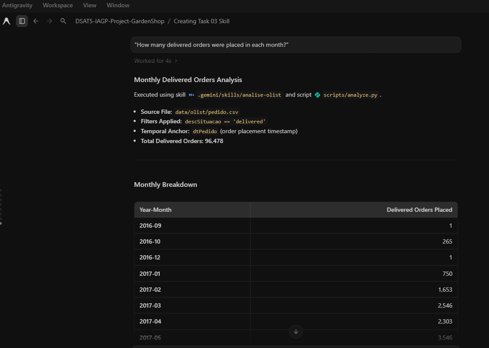
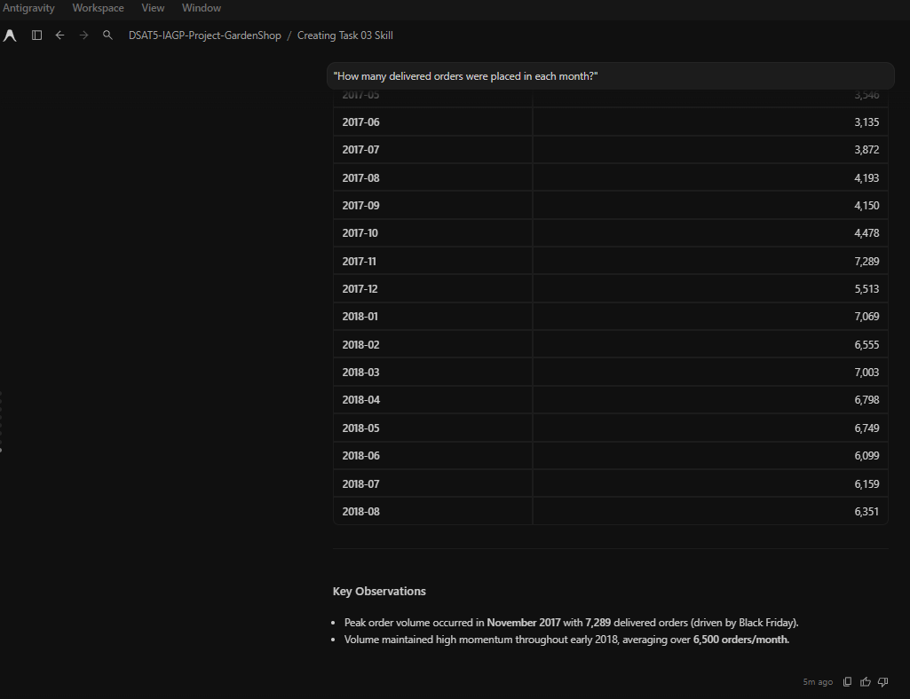
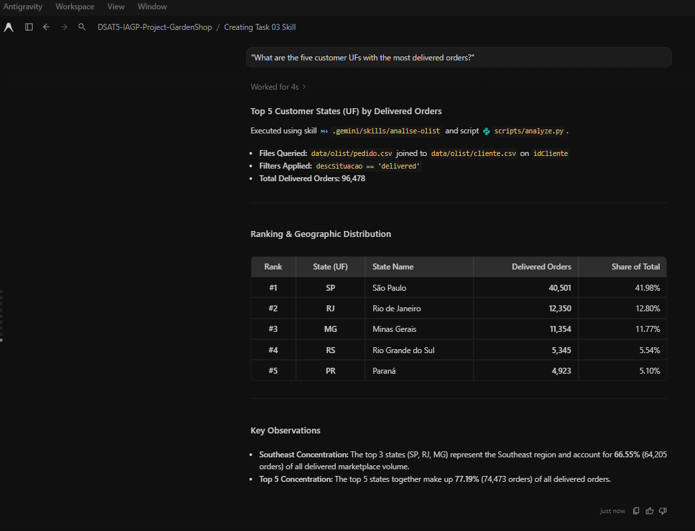
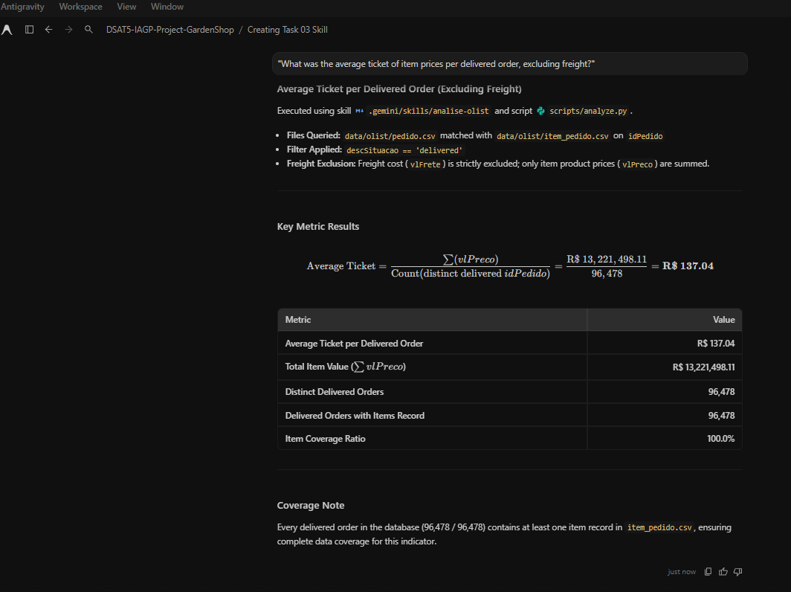
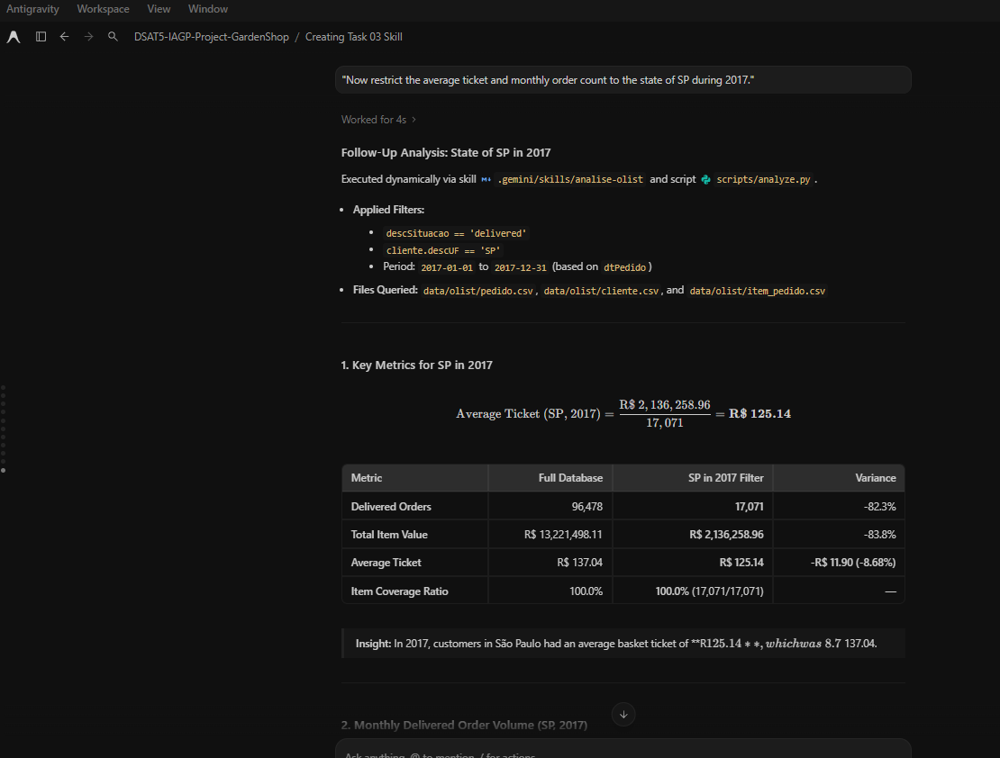
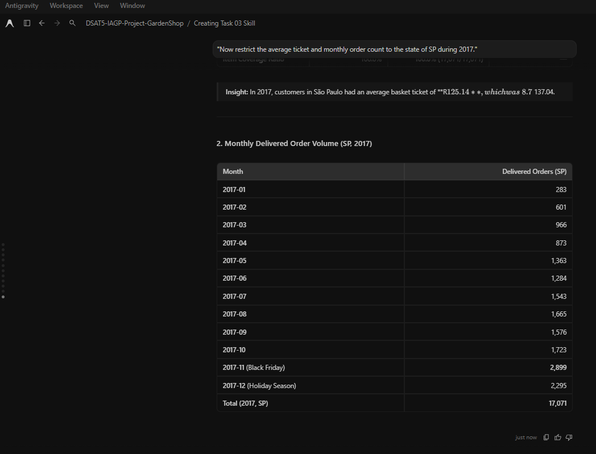
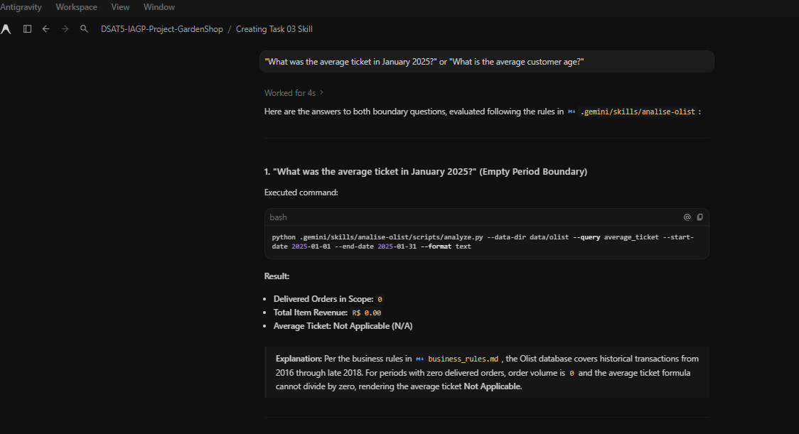
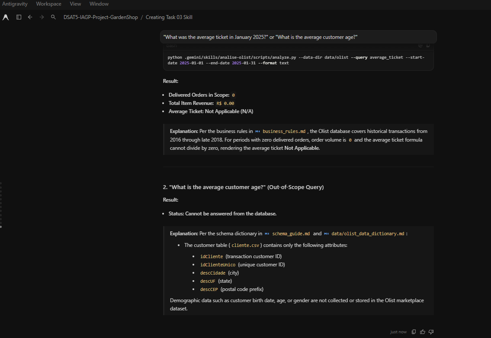

# Task 03 — Olist Analytics Copilot Skill (`analise-olist`)

This repository contains the deliverables for **Task 03**: an analytics copilot skill designed to query the Brazilian Olist e-commerce database, execute verifiable Python code, and present reproducible results without hardcoding numbers.

---

## 1. Directory Structure

```text
exercise/Task_03/
├── README.md                              # This reproduction guide
├── execution_log.md                       # Complete logs of tests and core analysis executions
├── brainstorming.md                       # Initial authoring brainstorm notes
└── skills/
    └── analise-olist/
        ├── SKILL.md                       # Official skill specification (en-US)
        ├── screenshots/                   # saved screenshots of the skill being used
        ├── references/
        │   ├── business_rules.md          # Business definitions, formulas & join rules
        │   └── schema_guide.md            # Schema dictionary, relations & foreign keys
        ├── scripts/
        │   └── analyze.py                 # Reusable analytics CLI engine (Pure Python standard library)
        └── tests/
            └── test_analysis.py           # Automated unit test suite (5/5 passing)
```

---

## 2. Requirements & Environment Setup

- **Python Version:** Python 3.10 or higher.
- **Dependencies:** None (uses strictly Python standard library: `csv`, `collections`, `argparse`, `json`, `unittest`).
- **Data Files:** The analyses require the Olist CSV files located in `data/olist/`:
  - `pedido.csv`
  - `cliente.csv`
  - `item_pedido.csv`
  - `pagamento_pedido.csv` (optional for ticket analysis)
  - `produto.csv`, `vendedor.csv`, `avaliacao_pedido.csv`

> **Note on Data Path:** By default, all scripts look for data at `./data/olist`. If your data is in a different directory, supply the `--data-dir <path>` argument.

---

## 3. Running Automated Tests

To run the automated verification suite (covering order counts, state rankings, average ticket calculation, zero-order periods, and subset filtering):

```bash
python -m unittest discover -s exercise/Task_03/skills/analise-olist/tests -p "test_*.py"
```

Expected output:
```text
.....
----------------------------------------------------------------------
Ran 5 tests in 1.5s

OK
```

---

## 4. How to Reproduce the Analyses

The analytics engine is located at `exercise/Task_03/skills/analise-olist/scripts/analyze.py`. You can run queries in both human-readable text format or JSON format.

### 4.1. Question 1: Monthly Delivered Orders
> *"How many delivered orders were placed in each month?"*

```bash
python exercise/Task_03/skills/analise-olist/scripts/analyze.py --data-dir data/olist --query monthly_orders --format text
```

### 4.2. Question 2: Top 5 Customer States (UF)
> *"What are the five customer UFs with the most delivered orders?"*

```bash
python exercise/Task_03/skills/analise-olist/scripts/analyze.py --data-dir data/olist --query top_ufs --top-n 5 --format text
```

**Results:**
1. SP: 40,501 orders (41.98%)
2. RJ: 12,350 orders (12.80%)
3. MG: 11,354 orders (11.77%)
4. RS: 5,345 orders (5.54%)
5. PR: 4,923 orders (5.10%)

### 4.3. Question 3: Average Ticket per Delivered Order
> *"What was the average ticket of item prices per delivered order, excluding freight?"*

```bash
python exercise/Task_03/skills/analise-olist/scripts/analyze.py --data-dir data/olist --query average_ticket --format text
```

**Formula:**
$$\text{Average Ticket} = \frac{\sum (vlPreco)}{\text{Count}(\text{distinct delivered } idPedido)} = \frac{\text{R\$ } 13,221,498.11}{96,478} = \text{R\$ } 137.04$$
- Freight (`vlFrete`) is excluded.
- Item coverage: 100.0% (all 96,478 delivered orders contain order items).

### 4.4. Follow-up Request: Period Restriction & State Filter
> *"Restrict the analysis to the state of SP during 2017."*

```bash
python exercise/Task_03/skills/analise-olist/scripts/analyze.py --data-dir data/olist --query all --start-date 2017-01-01 --end-date 2017-12-31 --uf SP --format text
```

**Results:**
- Delivered orders in scope: 17,071
- Average ticket: R$ 125.14
- Total item revenue: R$ 2,136,258.96

---

## 5. Edge Cases & Boundary Handling

1. **Empty Period (e.g. 2025):**
   ```bash
   python exercise/Task_03/skills/analise-olist/scripts/analyze.py --data-dir data/olist --query all --start-date 2025-01-01 --end-date 2025-01-31
   ```
   *Behavior:* Returns 0 orders, empty rankings, and average ticket reported as `Not Applicable (N/A)`.
2. **Out-of-Scope Questions:**
   *Behavior:* For questions on fields not present in the database (e.g. customer age, demographics), the copilot identifies missing attributes in `cliente.csv` and reports that the query cannot be answered.

For complete execution logs and raw JSON outputs, see [`exercise/Task_03/execution_log.md`](execution_log.md).


---

## 6. `SKILL.md` being used

### Question 1: 

> "How many delivered orders were placed in each month?"




### Question 2:

> "What are the five customer UFs with the most delivered orders?"



### Question 3:

> "What was the average ticket of item prices per delivered order, excluding freight?"



### Question 4: *Test Dynamic Follow-up Filter*

> "Now restrict the average ticket and monthly order count to the state of SP during 2017."




### Question 5: *Test Edge Case / Out of Scope*

> "What was the average ticket in January 2025?" or "What is the average customer age?"




